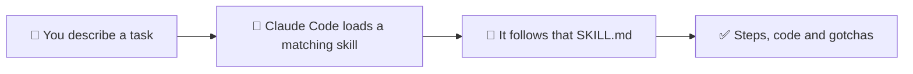

<div align="center">

# 🧠 ML / AI Skills Library

**38 ML and AI skills for Claude Code, from data cleaning to LLM evaluation.**

*Guidance to review before you use it, not certified code.*


[](https://github.com/NiravRVaghasiya/ml-ai-skills/actions/workflows/ci.yml)
[](LICENSE)

[Quick start](#-quick-start) · [What's inside](#-whats-inside) · [How to use it](#-how-to-use-it) · [Before you rely on it](#-before-you-rely-on-it) · [Contributing](#-contributing)

</div>

---

## 💡 What is this?

A **skill** is a single Markdown file (`SKILL.md`) that tells an AI assistant how to do one
ML/AI task, such as cleaning a dataset, evaluating a chatbot, or watching a deployed model
for problems.

This library is built for [Claude Code](https://code.claude.com/docs/en/skills), Anthropic's
AI coding assistant. Once installed, Claude Code can load a matching skill when you describe
a task. You can also just read the skills yourself, like a handbook.

There are two kinds of skill:

| | Type | What you get |
|---|---|---|
| ⚙️ | **Workflow** | Step-by-step instructions with copy-paste Python code |
| 📖 | **Reference** | A short explainer of the key ideas |

Every skill also lists its **gotchas** (mistakes people really make) and links to its
**sources** (mostly papers and official docs).

---

## 🚀 Quick start

You need [Claude Code](https://code.claude.com/docs/en/skills) installed. Then type these two
commands in Claude Code:

```
/plugin marketplace add NiravRVaghasiya/ml-ai-skills
/plugin install ml-ai-skills@ml-ai-skills
```

Now describe your task as usual, for example:

> *"Handle missing values and encode the categorical columns before training."*



Which skill Claude Code picks is up to Claude Code, and this repo does not test that step
(see [Before you rely on it](#-before-you-rely-on-it)).

### 📦 Other ways to install

Both options below deliver the same files. Use the plugin if you can, since it updates with
`/plugin update`. Use the installer for scripts, or for tools that only read
`~/.claude/skills/`.

<details>
<summary><b>Install a single domain</b> (smaller footprint)</summary>

After adding the marketplace (first command above):

```
/plugin install <domain>@ml-ai-skills
```

| `<domain>` | Skills |
|---|:---:|
| `foundations` | 4 |
| `classical-ml` | 6 |
| `deep-learning` | 6 |
| `llm` | 7 |
| `specialized` | 5 |
| `mlops` | 6 |
| `responsible-ai` | 3 |
| `security` | 1 |

The exact set per plugin is in [`.claude-plugin/marketplace.json`](.claude-plugin/marketplace.json).

</details>

<details>
<summary><b>Install without the plugin system</b> (plain files)</summary>

This copies the skill folders into `~/.claude/skills/`. It needs only `bash` and standard
command-line tools (including `sha256sum` or `shasum`), with no Python and no network access.
So far it has been tested on Windows (Git Bash) only.

```bash
git clone https://github.com/NiravRVaghasiya/ml-ai-skills.git
cd ml-ai-skills
./install.sh
```

In the table, `NAME` is a skill's folder name, such as `data-preprocessing`.

| Command | What it does |
|---|---|
| `./install.sh` | Install all skills into `~/.claude/skills/` |
| `./install.sh --project [DIR]` | Install into `./.claude/skills/` (or `DIR/.claude/skills/`) |
| `./install.sh --target DIR` | Install into any directory |
| `./install.sh --dry-run` | Preview only; writes nothing |
| `git pull && ./install.sh` | **Update.** Skills you edited are kept, with a warning |
| `./install.sh --force [--skill NAME]` | Overwrite your local edits, and any same-named folder the installer did not create (use `--skill` to limit it) |
| `./install.sh --prune` | Remove skills that were deleted upstream (unedited ones only) |
| `./uninstall.sh [--skill NAME] [--project] [--dry-run] [--force]` | Remove what the installer added |

Safety notes:

- Your edits are kept. Without `--force`, the installer never overwrites a skill you
  changed, and never touches folders it did not create.
- It refuses symlinks and never writes outside the target directory.
- If a run fails or is stopped, the old copy is moved back. If something else has taken its
  place, the old copy is kept in the lock directory for you to inspect.

`./bin/ml-ai-skills {install|update|uninstall|validate|list|help}` wraps the same commands
(`validate` and `list` need Python). Full behaviour, exit codes and recovery steps:
[`docs/INSTALLER.md`](docs/INSTALLER.md).

</details>

---

## 📚 What's inside

38 skills in 8 domains:

| Domain | Skills | Covers |
|---|:---:|---|
| 🧮 **Foundations** | 4 | ML math and statistics, Python/numpy/pandas idioms, framing an ML problem |
| 📊 **Classical ML** | 6 | Preprocessing, feature engineering, supervised/unsupervised learning, evaluation, tuning |
| 🧠 **Deep Learning** | 6 | Neural-net basics, CNNs, RNNs, attention/transformers, training loops, PyTorch patterns |
| 💬 **LLMs & GenAI** | 7 | Prompting, RAG, fine-tuning (LoRA/QLoRA), agents and tools, LLM/RAG/agent evaluation |
| 🎯 **Specialized** | 5 | Computer vision, NLP tasks, time series, recommender systems, reinforcement learning |
| 🏭 **MLOps** | 6 | Experiment tracking, deployment, monitoring, data pipelines, CI/CD, model optimization |
| ⚖️ **Responsible AI** | 3 | Fairness and bias metrics, explainability (SHAP/LIME), data privacy |
| 🔒 **Security** | 1 | Threats specific to ML models, LLMs and agents |

<details>
<summary><b>📋 See all 38 skills</b> (⚙️ W = workflow · 📖 R = reference)</summary>

#### 🧮 1. Foundations
| Skill | Type | Level |
|---|---|---|
| [`ml-math-essentials`](ml-math-essentials/SKILL.md) | 📖 R | beginner |
| [`ml-problem-framing`](ml-problem-framing/SKILL.md) | ⚙️ W | intermediate |
| [`python-for-ml`](python-for-ml/SKILL.md) | 📖 R | beginner |
| [`statistics-for-ml`](statistics-for-ml/SKILL.md) | 📖 R | intermediate |

#### 📊 2. Classical ML
| Skill | Type | Level |
|---|---|---|
| [`data-preprocessing`](data-preprocessing/SKILL.md) *(example to copy)* | ⚙️ W | intermediate |
| [`feature-engineering`](feature-engineering/SKILL.md) | ⚙️ W | intermediate |
| [`hyperparameter-tuning`](hyperparameter-tuning/SKILL.md) | ⚙️ W | advanced |
| [`model-evaluation`](model-evaluation/SKILL.md) | ⚙️ W | intermediate |
| [`supervised-learning`](supervised-learning/SKILL.md) | ⚙️ W | intermediate |
| [`unsupervised-learning`](unsupervised-learning/SKILL.md) | ⚙️ W | intermediate |

#### 🧠 3. Deep Learning
| Skill | Type | Level |
|---|---|---|
| [`attention-mechanisms`](attention-mechanisms/SKILL.md) *(example to copy)* | 📖 R | intermediate |
| [`cnn-vision`](cnn-vision/SKILL.md) | 📖 R | intermediate |
| [`neural-net-fundamentals`](neural-net-fundamentals/SKILL.md) | 📖 R | beginner |
| [`pytorch-patterns`](pytorch-patterns/SKILL.md) | ⚙️ W | intermediate |
| [`rnn-sequence`](rnn-sequence/SKILL.md) | 📖 R | intermediate |
| [`training-deep-models`](training-deep-models/SKILL.md) | ⚙️ W | intermediate |

#### 💬 4. LLMs & Generative AI
| Skill | Type | Level |
|---|---|---|
| [`agents-and-tools`](agents-and-tools/SKILL.md) | 📖 R | intermediate |
| [`agent-evaluation`](agent-evaluation/SKILL.md) | ⚙️ W | intermediate |
| [`fine-tuning-llms`](fine-tuning-llms/SKILL.md) | ⚙️ W | advanced |
| [`llm-evaluation`](llm-evaluation/SKILL.md) | ⚙️ W | intermediate |
| [`prompt-engineering`](prompt-engineering/SKILL.md) | 📖 R | beginner |
| [`rag-evaluation`](rag-evaluation/SKILL.md) | ⚙️ W | intermediate |
| [`rag-pipeline`](rag-pipeline/SKILL.md) | ⚙️ W | intermediate |

#### 🎯 5. Specialized Domains
| Skill | Type | Level |
|---|---|---|
| [`computer-vision`](computer-vision/SKILL.md) | ⚙️ W | intermediate |
| [`nlp-tasks`](nlp-tasks/SKILL.md) | ⚙️ W | intermediate |
| [`recommender-systems`](recommender-systems/SKILL.md) | ⚙️ W | intermediate |
| [`reinforcement-learning`](reinforcement-learning/SKILL.md) | 📖 R | intermediate |
| [`time-series`](time-series/SKILL.md) | ⚙️ W | intermediate |

#### 🏭 6. MLOps & Production
| Skill | Type | Level |
|---|---|---|
| [`ci-cd-for-ml`](ci-cd-for-ml/SKILL.md) | ⚙️ W | intermediate |
| [`data-pipelines`](data-pipelines/SKILL.md) | ⚙️ W | intermediate |
| [`experiment-tracking`](experiment-tracking/SKILL.md) | ⚙️ W | beginner |
| [`ml-monitoring`](ml-monitoring/SKILL.md) | ⚙️ W | intermediate |
| [`model-deployment`](model-deployment/SKILL.md) | ⚙️ W | intermediate |
| [`model-optimization`](model-optimization/SKILL.md) | ⚙️ W | advanced |

#### ⚖️ 7. Responsible AI
| Skill | Type | Level |
|---|---|---|
| [`ai-ethics-fairness`](ai-ethics-fairness/SKILL.md) | 📖 R | intermediate |
| [`data-privacy`](data-privacy/SKILL.md) | 📖 R | intermediate |
| [`explainability`](explainability/SKILL.md) | ⚙️ W | intermediate |

#### 🔒 8. AI/ML Security
| Skill | Type | Level |
|---|---|---|
| [`ai-ml-security`](ai-ml-security/SKILL.md) | 📖 R | intermediate |

</details>

---

## 🧭 How to use it

**1. Just ask.** After installing, describe your task and Claude Code loads a matching skill.

**2. Name a skill.** For example: *"Follow
[`data-preprocessing/SKILL.md`](data-preprocessing/SKILL.md) for this dataset."*

**3. Find a skill without installing anything.** A small script suggests the best skill for
a task. It runs offline and makes no AI calls:

```bash
python scripts/router.py "handle missing values and encode categorical features before training"
```

The line that matters in its output is the suggested skill:

```
  [workflow ] data-preprocessing   score=69.7   ...
```

It matches words, not meaning. So it can miss a request worded very differently from the
skill, and it can suggest a skill for an unrelated request that happens to share words
(e.g. *"monitor my blood pressure"*). Measured results: [`docs/ROUTING.md`](docs/ROUTING.md).

---

## 🔍 Before you rely on it

These skills are **guidance to review, not certified code**. Here is what has and has not
been checked:

| | Check | Status |
|---|---|---|
| ✅ | Every skill follows the same structure and rules | Checked automatically (`scripts/validate_skills.py`) |
| ✅ | The runnable Python in the 26 code-bearing skills runs | Run automatically on small made-up datasets, with outside services faked. GPUs, pretrained models and real services are not used |
| ✅ | The plugin installs, updates and reinstalls cleanly | Tested with the real `claude` command-line tool |
| ⚠️ | Specific API and version claims | Some are backed by a test and some are marked `unverified` ([`docs/claims.json`](docs/claims.json)). Most minimum versions in the skills are estimates |
| ❌ | Claude's answers improve with a skill loaded | Not measured. Eval cases are only scored against fixed sample answers |
| ❌ | Claude Code picks the right skill | Not tested |
| ❌ | Human expert review | None recorded yet |

Good to know:

- The header at the top of each `SKILL.md` has a **`risk_level`** (low, medium, high or
  critical): how much harm following it without review could cause. Take extra care with
  `high` and `critical` ones.
- `last_verified` in that header is the date the skill was last **reviewed**, not proof that
  it was re-tested.
- The code is tested against **pinned library versions**
  ([`requirements-examples.txt`](requirements-examples.txt)). Other versions may behave
  differently.
- Local testing was done on Windows. Linux and macOS are checked only by CI.
- Only Claude Code is supported. Other tools (Cursor, Copilot, …) are not tested.
  Uploading these files to claude.ai or the Skills API will probably fail, because each file
  has extra header fields those services don't accept.

All open issues, by severity: [`docs/KNOWN-ISSUES.md`](docs/KNOWN-ISSUES.md).
More detail: [`docs/EVIDENCE.md`](docs/EVIDENCE.md) and [`docs/COMPATIBILITY.md`](docs/COMPATIBILITY.md).

---

## 📈 Project at a glance

<!-- PROJECT-STATS:START -->
<!-- Generated by `python scripts/generate_readme_stats.py --write`. Do not hand-edit
     this block — your changes will be overwritten. Edit skill frontmatter, scripts/,
     tests/, docs/, or evals/ instead, then regenerate. -->

| Metric | Value |
|---|---|
| Skills | **38** (workflow (25) · reference (13)) |
| Domains | 8 — foundations (4) · classical-ml (6) · deep-learning (6) · llm (7) · specialized (5) · mlops (6) · responsible-ai (3) · security (1) |
| Level | beginner (5) · intermediate (30) · advanced (3) |
| Risk level | low (23) · medium (13) · high (2) |
| Evidence level | primary (3) · official-documentation (10) · established-practice (25) |
| Eval cases | 83 case file(s) covering 38/38 skills — graded offline against pass/fail fixtures by regex hard assertions; no model output graded (see `evals/SCHEMA.md`) |
| Unit tests | 666 in the default suite (`tests/test_*.py`, stdlib only) + 351 optional example tests (`tests/examples/`, need `requirements-examples.txt`) |
| Scripts / docs | 22 scripts in `scripts/`, 13 policy docs in `docs/` |
<!-- PROJECT-STATS:END -->

---

## 🤝 Contributing

New skills and fixes are welcome.

1. Read [`CONTRIBUTING.md`](CONTRIBUTING.md): the step-by-step guide and review checklist.
2. Copy [`_TEMPLATE/SKILL.md`](_TEMPLATE/SKILL.md) and match the two example skills:
   [`data-preprocessing`](data-preprocessing/SKILL.md) (workflow) and
   [`attention-mechanisms`](attention-mechanisms/SKILL.md) (reference).
3. Run the main check before opening a pull request:

   ```bash
   python scripts/validate_skills.py --warnings
   ```

The authoring rules for AI agents are in [`CLAUDE.md`](CLAUDE.md). The formal skill format
is in [`docs/SKILL-SPEC.md`](docs/SKILL-SPEC.md). To report a security issue privately, see
[`SECURITY.md`](SECURITY.md).

<details>
<summary><b>🛠️ Tooling for maintainers</b></summary>

All scripts use only the Python standard library (nothing to `pip install`).
[CI](.github/workflows/ci.yml) runs the validation, eval, routing, generated-file and test
checks on pushes to `main` and on pull requests. `router.py` and `quality_report.py` are
local tools; CI does not run them.

| Command | What it does |
|---|---|
| `python scripts/validate_skills.py --warnings` | Main gate: front-matter, sections, links, relationships, INDEX sync |
| `python scripts/validate_evals.py --strict --coverage` | Eval cases, assertion lint, fixture self-tests, per-skill coverage |
| `python scripts/run_evals.py --out eval-report.json` | Offline eval report (`--compare A B` finds regressions) |
| `python scripts/eval_router.py --split test --json` | Routing benchmark metrics |
| `python scripts/router.py "your task"` | Preview which skill a task routes to |
| `python scripts/check_contract.py --check` | Public contract (slugs, plugins, enums, VERSION) matches its lock |
| `python scripts/check_claims.py` | Claims registry is well-formed and names real tests |
| `python scripts/check_freshness.py` | Offline check for removed APIs and overdue reviews |
| `python scripts/check_generated.py` | Generated files (INDEX, README stats, plugins, graph, schema) match their generators |
| `python scripts/quality_report.py --out quality-report.json` | Machine-readable report of what was checked and what was skipped |
| `python -m unittest discover -s tests/examples -t tests -p "test_*.py"` | Example suite: runs the skills' code (needs `requirements-examples.txt`) |
| `claude plugin validate . --strict` | Native plugin schema check (needs the `claude` CLI) |

| Doc | Covers |
|---|---|
| [`docs/SKILL-SPEC.md`](docs/SKILL-SPEC.md) | The formal skill format |
| [`docs/EVIDENCE.md`](docs/EVIDENCE.md), [`docs/FRESHNESS.md`](docs/FRESHNESS.md) | Evidence tiers, claims registry, freshness policy |
| [`docs/EXAMPLE-TESTS.md`](docs/EXAMPLE-TESTS.md) | How SKILL.md code is executed |
| [`evals/SCHEMA.md`](evals/SCHEMA.md) | Eval case format and what is (not) measured |
| [`docs/ROUTING.md`](docs/ROUTING.md) | Router algorithm, benchmark results, known failure modes |
| [`docs/QUALITY-GATES.md`](docs/QUALITY-GATES.md) | Which gates CI enforces |
| [`docs/COMPATIBILITY.md`](docs/COMPATIBILITY.md) | Supported environments |
| [`docs/RELEASE.md`](docs/RELEASE.md) | Versioning and release steps |
| [`docs/INSTALLER.md`](docs/INSTALLER.md) | Installer contract and threat model |
| [`docs/SKILL-GRAPH.md`](docs/SKILL-GRAPH.md) | Generated graph of how skills relate |
| [`docs/KNOWN-ISSUES.md`](docs/KNOWN-ISSUES.md) | Every open issue, by severity |

</details>

<details>
<summary><b>🗂️ Project structure</b></summary>

```
ml-ai-skills/
├── <skill-name>/SKILL.md   ← the skills themselves (edit these, never the copies in plugins/)
├── _TEMPLATE/SKILL.md      ← starting point for a new skill
├── INDEX.md                ← one line per skill (generated)
├── plugins/                ← Claude Code plugins (generated copies of the skills)
├── .claude-plugin/         ← marketplace manifest (generated)
├── install.sh, uninstall.sh, bin/  ← plain-file installer
├── scripts/                ← validator, router, evals, generators, quality report
├── tests/                  ← unit tests; tests/examples/ runs the skills' code
├── evals/                  ← per-skill eval cases and the routing benchmark
├── schema/                 ← allowed values, JSON Schema, contract lock
├── docs/                   ← specs, policies, known issues
└── CLAUDE.md, CONTRIBUTING.md, SECURITY.md, CHANGELOG.md, VERSION
```

</details>

---

## 📄 License

[MIT](LICENSE) © 2026 Nirav Vaghasiya. You can use, modify and share it, including
commercially, as long as you keep the copyright notice and license text.
